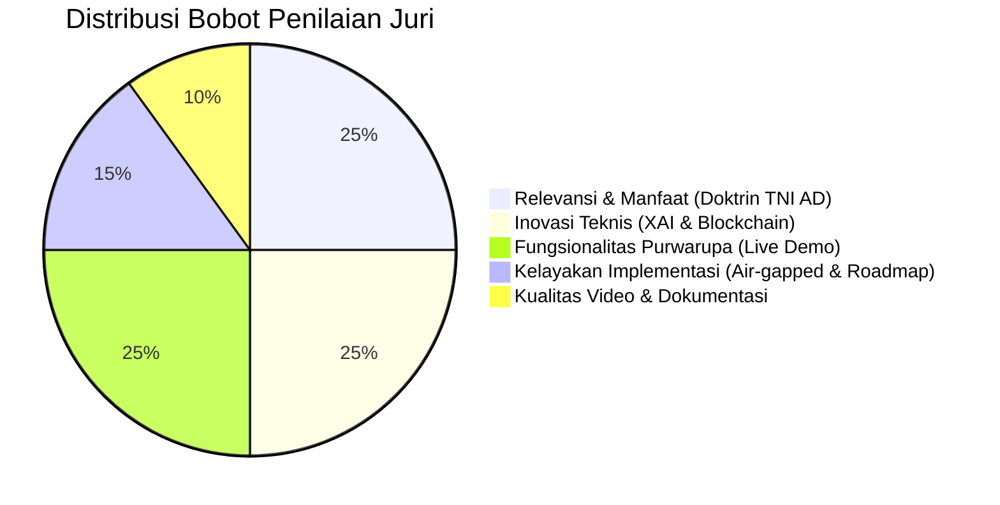
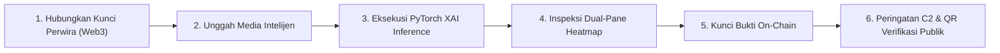

# MASTER PLAN & STORYBOARD PRODUKSI VIDEO KARYA (MAKSIMAL 10 MENIT)
## SENTINEL-AD: Tactical Cognitive Warfare Defense & Immutable Evidence Custody System
### *Kartika Cyber Hackathon 2026 — PUSSIBERAD × CODEPOLITAN*

---

## 🎯 1. Informasi & Spesifikasi Teknis Video

| Parameter | Spesifikasi | Keterangan |
|---|---|---|
| **Durasi Maksimal** | 09:45 – 09:55 (Target aman: < 10 Menit) | Sesuai aturan Rulebook Bab V Poin 4 (Maks. 10 Menit) |
| **Platform Target** | YouTube (Unlisted / Public) | Format tautan disubmit di platform hackathon |
| **Resolusi & Frame Rate** | 1080p (1920×1080) / 4K @ 60 FPS | Jelas saat menampilkan heatmap piksel dan kode hash |
| **Format Audio** | Stereo 48kHz, Voiceover jelas, Noise reduction | Latar musik: Low-tempo Dark Tactical Synth / Military Cyber |
| **Gaya Penyampaian** | Taktis, Tegas, Ilmiah, Percaya Diri (*Military-Grade Rigor*) | Hindari gaya santai/vlog; gunakan terminologi komando |
| **Format Tampilan** | Picture-in-Picture (Presenter di pojok kanan bawah + Screencast Full-HD) | Menunjukkan orisinalitas dan kesiapan presentasi |

---

## ⚖️ 2. Pemetaan Terhadap Kriteria Penilaian Juri (Bobot 100%)

Video ini dirancang secara sistematis untuk menjawab seluruh rubrik evaluasi resmi:

1. **Relevansi dan Manfaat (25%):** Ditampilkan pada **Segmen 1, 2, & 3** — Menjawab ancaman perang hibrida kognitif, memangkas siklus klarifikasi dari 48 jam menjadi < 3 menit, serta keabsahan bukti ISO/IEC 27037.
2. **Inovasi Teknis (25%):** Ditampilkan pada **Segmen 4B, 4C, & 5** — Explainable AI (Grad-CAM Visual Heatmap, bukan probabilitas black-box) dipadukan dengan Smart Contract RBAC Polygon Amoy & IPFS Vault.
3. **Fungsionalitas Purwarupa (25%):** Ditampilkan pada **Segmen 4 (Live Demo Golden Flow)** — Menunjukkan aplikasi nyata berjalan lokal (Next.js 14, FastAPI, Three.js 3D Holo-Globe, Web3 signing, dan pemindaian QR interaktif).
4. **Kelayakan Implementasi (15%):** Ditampilkan pada **Segmen 5 & 6** — Kemampuan deployment lokal mandiri (*air-gapped ready*), tanpa ketergantungan API pihak ketiga, dan roadmap integrasi K3I/C4ISR TNI AD.
5. **Kualitas Dokumentasi & Video (10%):** Struktur video yang runtut, audio tajam, visual grafis profesional, dan demonstrasi tanpa jeda error.

---

## ⏱️ 3. Precision Timeline & Storyboard Matrix (10 Menit)

| Waktu | Segmen | Fokus Utama | Target Juri |
|---|---|---|---|
| **00:00 - 01:00** | Segmen 1 | Hook Taktis & Identitas Karya | Relevansi & First Impression |
| **01:00 - 02:30** | Segmen 2 | Problem Statement & Medan Operasi Kognitif | Relevansi Kebutuhan TNI AD (25%) |
| **02:30 - 04:00** | Segmen 3 | Solusi & 4 Pilar Pertahanan Strategis | Inovasi Teknis & Manfaat (25%) |
| **04:00 - 07:30** | Segmen 4 | **Live Demonstration (The Golden Operational Flow)** | Fungsionalitas Purwarupa (25%) |
| **07:30 - 08:45** | Segmen 5 | Arsitektur Teknis, Kedaulatan & Air-Gapped | Inovasi & Kemandirian Teknologi |
| **08:45 - 09:30** | Segmen 6 | Kelayakan Implementasi & Roadmap Operasional | Kelayakan Implementasi (15%) |
| **09:30 - 09:50** | Segmen 7 | Kesimpulan, Slogan & Penutup Komando | Kejelasan & Final Conviction (10%) |

---

## 🎬 4. Skrip Rinci per Segmen (Visual, Narasi, & Audio)

### SEGMEN 1: HOOK TAKTIS & PEMBUKAAN (00:00 – 01:00)
* **Visual On-Screen:**
  - Detik 0–10: Layar hitam, suara denyut radar taktis (*sonar ping*). Muncul visual 3D Holo-Globe Indonesia dengan garis busur ancaman menyala merah di atas Command Center.
  - Detik 10–25: Transisi dinamis ke wajah presenter (seragam rapi/taktis) dengan lower-third: `[NAMA PRESENTER] // KARTIKA CYBER HACKATHON 2026`.
  - Detik 25–60: Montage cepat: Logo PUSSIBERAD, lambang Kartika Eka Paksi, dan judul besar: **SENTINEL-AD**.
* **Audio & SFX:** Musik ambient synth berwibawa (*military electronic underscore*).
* **Skrip Narasi (Voiceover):**
  > "Selamat pagi Dewan Juri yang kami hormati dan rekan-rekan pejuang siber Kartika Cyber Hackathon 2026.
  > Di era perang modern, medan pertempuran telah berevolusi melampaui matra darat, laut, dan udara. Hari ini, ancaman paling berbahaya tidak hanya menembus perimeter server, melainkan membajak persepsi publik dan memecah belah rantai komando militer melalui kecerdasan buatan generatif: *Deepfake* dan *Cognitive Warfare*.
  > Menjawab tantangan strategis ini, kami mempersembahkan: **SENTINEL-AD: Siber Evidensi Nasional & Taktis Intelijen Elektronik — Angkatan Darat**. Sistem pertahanan perang kognitif mutakhir berstandar militer yang memadukan **Explainable AI Forensics** dan **Buku Besar Terdesentralisasi Anti-Penyangkalan**."

---

### SEGMEN 2: LATAR BELAKANG & PROBLEM STATEMENT (01:00 – 02:30)
* **Visual On-Screen:**
  - Slide infografis taktis / capture simulasi insiden:
    1. Cuplikan simulasi video manipulasi pidato/perintah palsu pimpinan militer.
    2. Grafik perbandingan waktu: Siklus klarifikasi konvensional (6 – 48 jam) vs viralitas hoaks (< 15 menit).
    3. Ilustrasi server terpusat dengan label merah: *Vulnerable to Insider Tampering & Foreign Denial*.
* **Audio & SFX:** Sound effect *alert glitch* halus saat menampilkan ancaman.
* **Skrip Narasi (Voiceover):**
  > "Mengapa ancaman ini sangat kritis bagi TNI AD? Ada tiga titik kelemahan fundamental dalam penanganan disinformasi saat ini:
  > Pertama, **Ketiadaan Rantai Bukti yang Sah (*Lack of Chain of Custody*)**. Ketika rekaman video palsu beredar dan dijadikan alat provokasi, bukti di server konvensional rawan dituduh hasil rekayasa balik, dihapus oleh ancaman orang dalam (*insider threat*), atau disangkal musuh di peradilan hukum internasional.
  > Kedua, **Dilema Black-Box AI**. Sebagian besar pendeteksi deepfake hanya memberikan persentase angka hitam-putih. Komandan lapangan dan penyidik hukum militer tidak dapat mengambil tindakan hanya berdasarkan angka probabilitas tanpa bukti visual konkret.
  > Dan ketiga, **Keterlambatan Siklus Klarifikasi**. Membutuhkan 6 hingga 48 jam bagi tim forensik manual untuk memverifikasi sebuah video. Padahal dalam hitungan menit, disinformasi tersebut telah memicu keresahan sosial dan mengancam stabilitas nasional."

---

### SEGMEN 3: SOLUSI & MANFAAT STRATEGIS (02:30 – 04:00)
* **Visual On-Screen:**
  - Tampilan landing page SENTINEL-AD (menyorot bagian Hero panoramik yang telah diperbaiki, emblem TNI AD, dan 4 Pilar Pertahanan).
  - Skema 4 Pilar muncul berurutan dengan animasi elegan:
    1. *Explainable AI (Grad-CAM)*
    2. *Immutable Evidence Custody (Polygon Amoy & IPFS)*
    3. *Tactical C2 & COP 3D Globe*
    4. *Public Verification Portal (QR Code)*
* **Skrip Narasi (Voiceover):**
  > "SENTINEL-AD hadir sebagai solusi komprehensif berstandar ISO/IEC 27037 untuk menutup seluruh celah tersebut melalui empat pilar pertahanan:
  > 1. **Explainable AI Forensics:** Kami tidak hanya mendeteksi manipulasi, tetapi membuktikan piksel mana yang direkayasa melalui *Grad-CAM Visual Heatmap* berbasis analisis anomali frekuensi Laplacian dan inkonsistensi biometrik.
  > 2. **Immutable Evidence Custody:** Mengunci sidik jari kriptografis (SHA-256), tanda tangan digital perwira berstandar EIP-712, serta rekaman IPFS ke dalam smart contract blockchain Polygon Amoy. Sekali terkunci, bukti ini abadi dan mustahil diubah siapapun.
  > 3. **Tactical C2 & Common Operational Picture:** Memetakan insiden ke dalam Holo-Globe 3D secara real-time ke seluruh jajaran 15 Kodam kewilayahan.
  > 4. **Public Verification Portal:** Memangkas waktu tangkal hoaks menjadi **kurang dari 3 menit** melalui portal verifikasi publik berbasis QR Code resmi yang dapat diakses masyarakat dan penerangan militer."

---

### SEGMEN 4: LIVE DEMO — THE GOLDEN OPERATIONAL FLOW (04:00 – 07:30)
*Segmen inti paling berbobot. Tampilkan interaksi layar secara penuh, kursor jelas, tanpa jeda.*

#### Tahap 4A: Otentikasi Perwira Analis (04:00 – 04:30)
* **Aksi Layar:**
  - Buka `http://localhost:3000/dashboard`.
  - Klik tombol taktis `[ HUBUNGKAN IDENTITAS PERWIRA ]`.
  - MetaMask terpicu otomatis pada jaringan Polygon Amoy Testnet (Chain ID 80002).
  - Tampilkan lencana perwira: `KAPTEN ANALIS // 0x8F2B...` dengan status role `EVIDENCE_OFFICER_ROLE`.
* **Narasi:**
  > "Mari kita saksikan operasional langsung sistem SENTINEL-AD. Perwira Analis PUSSIBERAD masuk ke Command Center menggunakan identitas kriptografis taktis berbasis dompet Web3 terotentikasi. Role-Based Access Control (RBAC) pada smart contract menjamin hanya perwira terotorisasi yang berhak memasukkan bukti ke rantai komando."

#### Tahap 4B: Ingestion Media & Analisis AI Forensik (04:30 – 05:15)
* **Aksi Layar:**
  - Buka modul *Media Ingestion*.
  - Drag-and-drop video sampel `provokasi_deepfake.mp4`.
  - Sistem menghitung hash SHA-256 secara instan.
  - Klik tombol `[ EKSEKUSI ANALISIS FORENSIK MULTIMODAL ]`.
  - Terminal/progress radar berputar: ekstraksi frame OpenCV, analisis frekuensi Fourier, dan inferensi neural network PyTorch (berjalan dalam ~5-7 detik).
* **Narasi:**
  > "Ketika media mencurigakan ditemukan oleh patroli siber, file dimasukkan ke Media Ingest. Sistem langsung menghitung hash SHA-256 untuk menjamin integritas awal. Engine FastAPI lokal kami mengekstraksi frame, menganalisis diskontinuitas gradien warna, artefak GAN pada tepi wajah, dan anomali spektrum frekuensi."

#### Tahap 4C: Inspeksi Explainable AI Dual-Pane (05:15 – 06:00)
* **Aksi Layar:**
  - Layar berkedip taktis menjadi **CRIMSON ALERT (DEFCON 2)**.
  - Skor keyakinan: **97.4% MANIPULATED (SINTETIS)**.
  - Tampilkan tampilan **Dual-Pane Forensic Viewer**:
    - Panel Kiri: Video asli.
    - Panel Kanan: **Grad-CAM Visual Heatmap**.
  - Sorot area merah menyala di batas rahang (*jawline blending artifact*) dan sinkronisasi bibir.
* **Narasi:**
  > "Inilah keunggulan utama Explainable AI SENTINEL-AD. Sistem tidak hanya menyatakan 'Palsu 97.4%', melainkan memperlihatkan *Visual Anomaly Heatmap*. Sinar merah pekat pada area rahang dan bibir membuktikan secara ilmiah adanya penempelan wajah sintetis model difusi. Inilah bukti empiris yang memenuhi standar pembuktian hukum militer."

#### Tahap 4D: Penguncian Rantai Bukti On-Chain (06:00 – 06:45)
* **Aksi Layar:**
  - Perwira mengklik tombol hijau bercahaya: `[ KUNCI BUKTI RANTAI KOMANDO ]`.
  - Metadata forensik diunggah ke IPFS Tactical Vault (Pinata).
  - Transaksi smart contract dieksekusi di Polygon Amoy: memanggil fungsi `lockEvidence(...)`.
  - Transaksi sukses dalam 3 detik. Menampilkan TX Hash dan tautan PolygonScan.
* **Narasi:**
  > "Perwira analis kemudian mengunci hasil temuan ke buku besar militer. Dalam satu klik, hash media, metadata forensik di IPFS, skor anomali, dan identitas perwira terkunci permanen di smart contract `TacticalEvidenceRegistry`. Integritas rantai komando terlindungi secara mutlak: tidak ada pihak yang dapat memanipulasi atau menghapus catatan ini."

#### Tahap 4E & 4F: Peringatan C2 3D Globe & Verifikasi Publik (06:45 – 07:30)
* **Aksi Layar:**
  - Smart contract memancarkan event `TacticalC2Alert`.
  - Holo-Globe 3D otomatis bereaksi: memancarkan busur merah dari Mabes menuju Kodam wilayah terdampak (misal Kodam Jaya / Kodam I).
  - Sistem memunculkan **Sertifikat Forensik Digital Resmi** lengkap dengan QR Code publik.
  - Tunjukkan demonstrasi scan QR Code dengan kamera handphone -> membuka URL `/verify` publik berstatus: *"KONTEN DINYATAKAN PALSU OLEH PUSSIBERAD"*.
* **Narasi:**
  > "Secara otomatis, smart contract memicu sinyal peringatan taktis pada Globe 3D C2, mengarahkan perhatian pimpinan ke Kodam sasaran disinformasi. Pada detik yang sama, sistem menerbitkan Sertifikat Bukti Digital ber-QR Code. Satuan Penerangan TNI AD (Dispenad) dapat menyebarkannya seketika ke publik. Masyarakat cukup memindai QR Code untuk membuktikan kebohongan musuh dalam kurun waktu kurang dari 3 menit!"

---

### SEGMEN 5: ARSITEKTUR TEKNOLOGI & KEDAULATAN DATA (07:30 – 08:45)
* **Visual On-Screen:**
  - Diagram arsitektur sistem modular:
    - *Frontend:* Next.js 14 App Router, Three.js, Wagmi v2, TailwindCSS.
    - *AI Engine:* Python 3.10+, FastAPI, PyTorch, Torchvision, OpenCV.
    - *Ledger:* Solidity 0.8.20, OpenZeppelin AccessControl, Polygon Amoy.
    - *Vault:* IPFS Resilient Node.
  - Tampilkan containerization Docker (`docker-compose.yml`, Nginx Gateway) dan sertifikasi kepatuhan ISO/IEC 27037.
* **Skrip Narasi (Voiceover):**
  > "SENTINEL-AD dibangun dengan arsitektur tangguh yang mengutamakan **Kedaulatan Data dan Kesiapan Lingkungan Terisolasi (*Air-Gapped Readiness*)**.
  > Seluruh AI engine berjalan lokal menggunakan container Docker mandiri, tanpa mengirimkan satu byte pun data intelijen ke API cloud publik komersial luar negeri. Kode smart contract kami diaudit dengan pengujian unit Hardhat 100% lolos, menerapkan Role-Based Access Control ketat, dan siap dimigrasikan ke jaringan blockchain tertutup (*Permissioned Military Ledger*) seperti Hyperledger Besu."

---

### SEGMEN 6: KELAYAKAN IMPLEMENTASI & ROADMAP (08:45 – 09:30)
* **Visual On-Screen:**
  - Slide Roadmap Implementasi Militer (Fase 1, 2, dan 3):
    - *Fase 1 (Saat ini):* Functional Prototype Berstandar Produksi.
    - *Fase 2 (3–6 Bulan):* Crawling Radar OSINT Otomatis & Analisis Denyut Biologis rPPG.
    - *Fase 3 (1 Tahun):* Integrasi penuh Sistem Komando Kendali Terpadu (C4ISR) Tri-Matra TNI.
* **Skrip Narasi (Voiceover):**
  > "Dari sisi kelayakan implementasi, SENTINEL-AD bukan sekadar konsep di atas kertas. Purwarupa yang kami demonstrasikan hari ini telah berstatus *production-grade*.
  > Roadmap kami meliputi penambahan sensor radar OSINT otomatis untuk memantau lalu lintas media sosial 24/7, analisis biometrik detak jantung sintetis (*rPPG remote photoplethysmography*), serta integrasi ke dalam sistem K3I/C4ISR Mabes TNI. SENTINEL-AD sangat fisibel dan siap diuji gelar di lingkungan satuan PUSSIBERAD."

---

### SEGMEN 7: KESIMPULAN & PENUTUP KOMANDO (09:30 – 09:50)
* **Visual On-Screen:**
  - Presenter kembali di layar penuh dengan sikap tegap dan percaya diri.
  - Slide penutup: Lambang PUSSIBERAD, lambang Kartika Cyber Hackathon, identitas tim, dan slogan komando.
* **Skrip Narasi (Voiceover):**
  > "Dewan Juri yang kami muliakan,
  > SENTINEL-AD adalah bukti dedikasi kami untuk membentengi kedaulatan informasi Republik Indonesia. Dengan perpaduan Explainable AI dan Blockchain yang tidak dapat disangkal, kita memenangkan perang kognitif sebelum musuh sempat menyebarkan keraguan.
  > Bersama Pusat Siber Angkatan Darat, kita tegakkan kedaulatan siber Nusantara!
  > *Satria Yudha Waskita!* Terima kasih."

---

## 🛠️ 5. Panduan Praktis Produksi & Checklist Rekaman

### A. Persiapan Sebelum Recording:
- [ ] Pastikan backend FastAPI aktif: `http://localhost:8000/health` (Status `OPERATIONAL`).
- [ ] Pastikan frontend Next.js aktif: `http://localhost:3000` (Hero bersih tanpa garis potong).
- [ ] Buka MetaMask, pastikan akun memiliki saldo MATIC di Polygon Amoy Testnet.
- [ ] Siapkan file video sampel deepfake di Desktop (`provokasi_deepfake.mp4`).
- [ ] Siapkan smartphone dengan aplikasi kamera/QR scanner yang terkoneksi ke jaringan sama untuk demo scan QR langsung ke kamera.

### B. Pengaturan OBS Studio / Perekam Layar:
- **Canvas:** 1920×1080 (16:9), 60 FPS.
- **Audio Mic:** Sampling 48kHz, aktifkan filter *Noise Suppression* (RNNoise) dan *Compressor*.
- **Bitrate Rekaman:** 12,000 – 16,000 Kbps (CBR, NVENC/QuickSync/x264).
- **Scene Setup:**
  - *Scene 1 (Intro/Closing):* Kamera Full Screen + Motion Graphic Title.
  - *Scene 2 (Live Demo):* Screen Capture Full + Webcam presenter kecil berbentuk rounded rectangle di pojok kanan bawah.

### C. Kunci Sukses Penilaian (Tips Juara):
1. **Kejelasan Artikulasi:** Gunakan intonasi tegas dan berwibawa. Setiap istilah teknis (Grad-CAM, EIP-712, ISO/IEC 27037) diucapkan dengan fasih.
2. **Kesesuaian Waktu:** Jangan melebihi 10 menit. Stop di menit 09:45 – 09:55 untuk menghindari penalti diskualifikasi rulebook.
3. **Pembuktian Real-Time:** Juri sangat menghargai ketika transaksi blockchain benar-benar terkonfirmasi dan QR code benar-benar bisa di-scan dan membuka halaman verifikasi.
